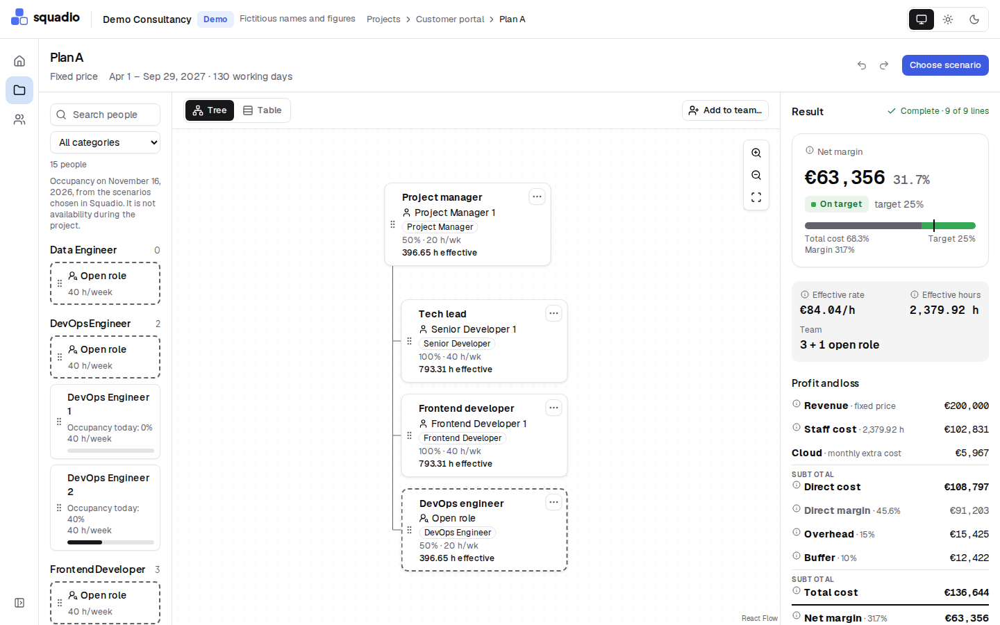
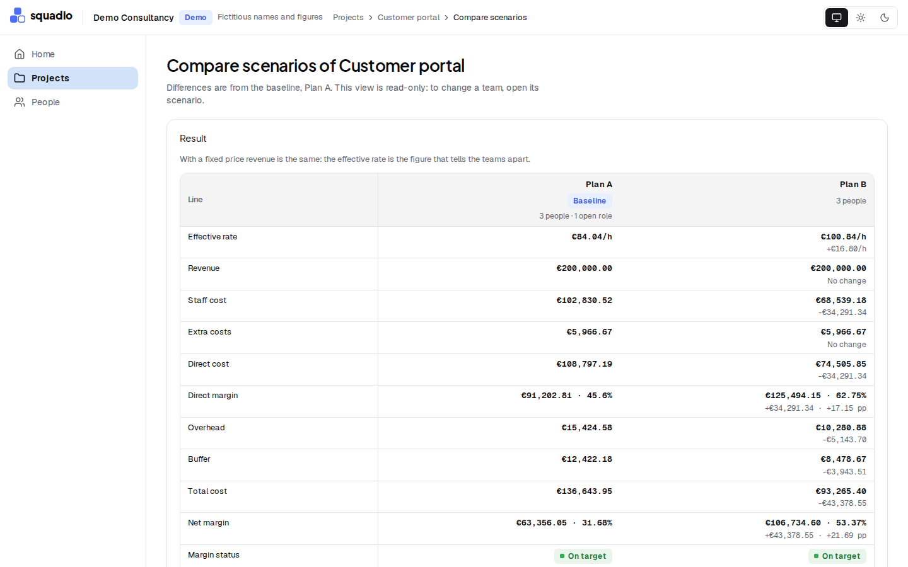
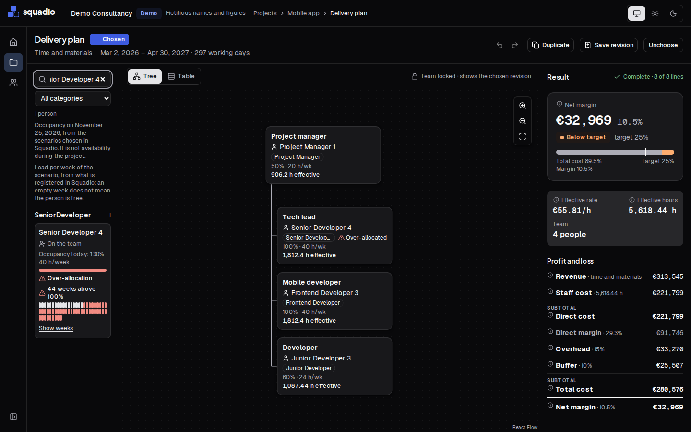
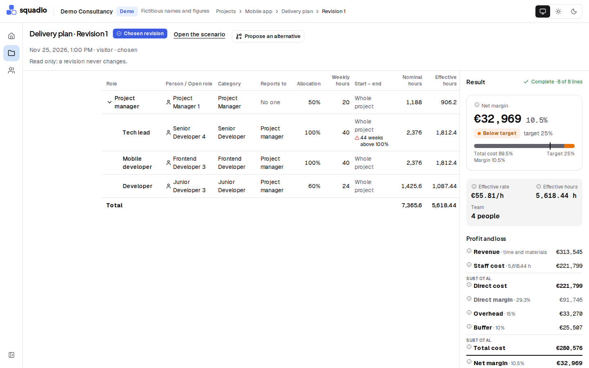
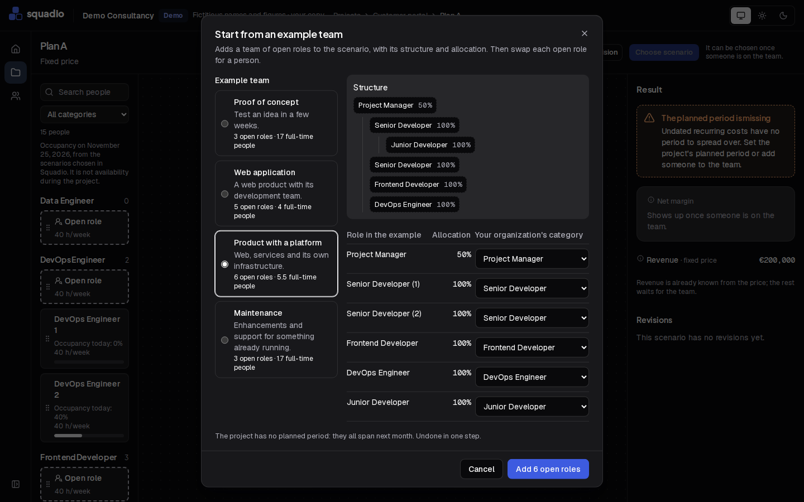
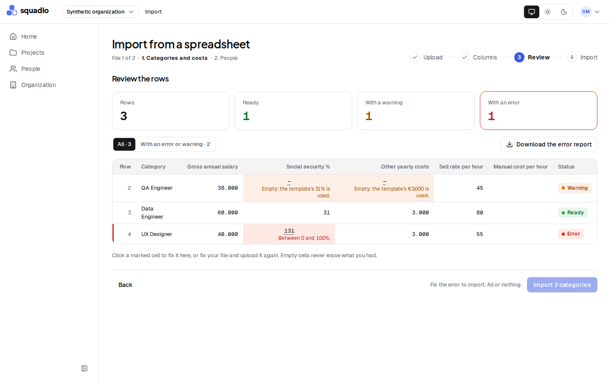
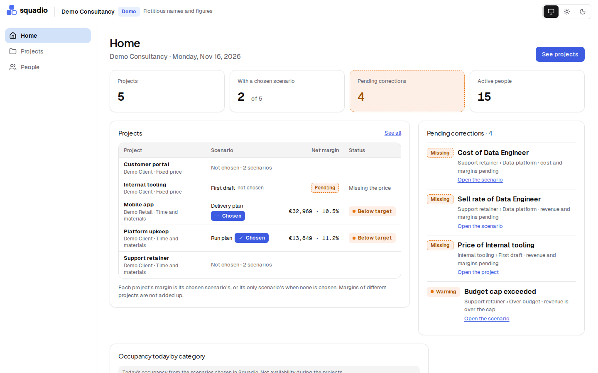
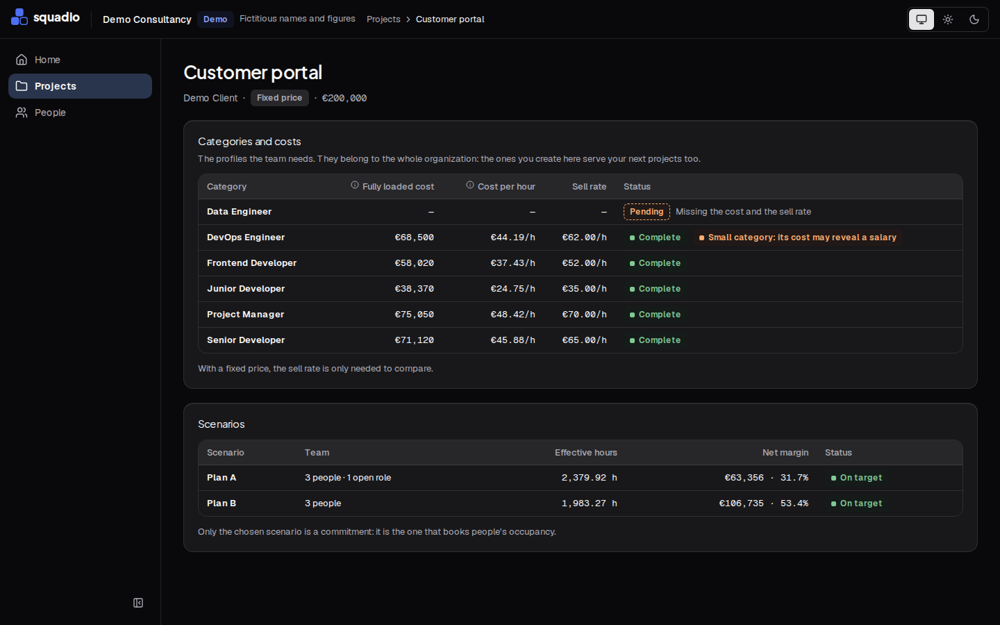
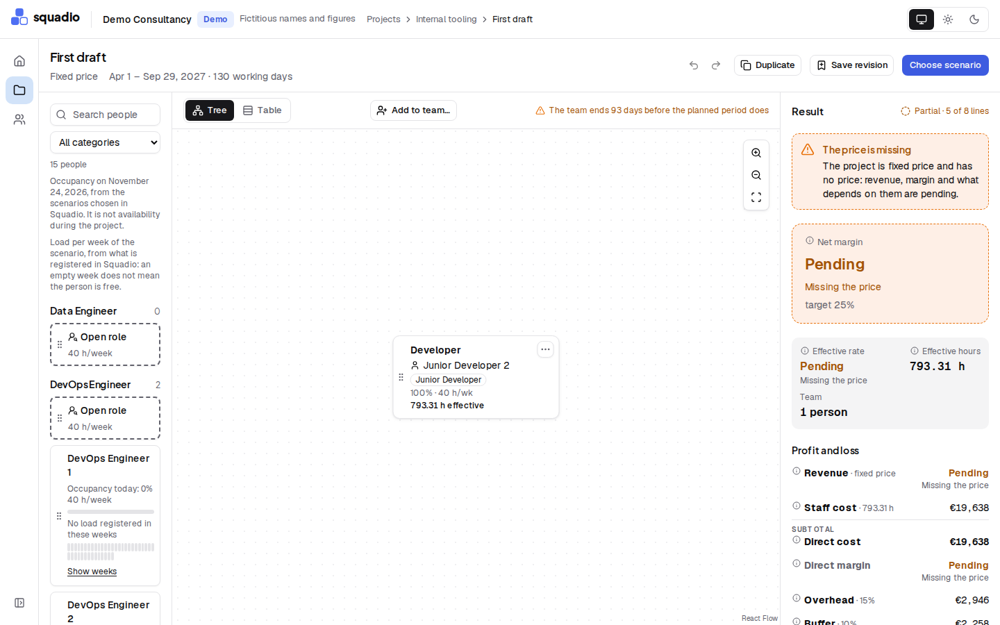
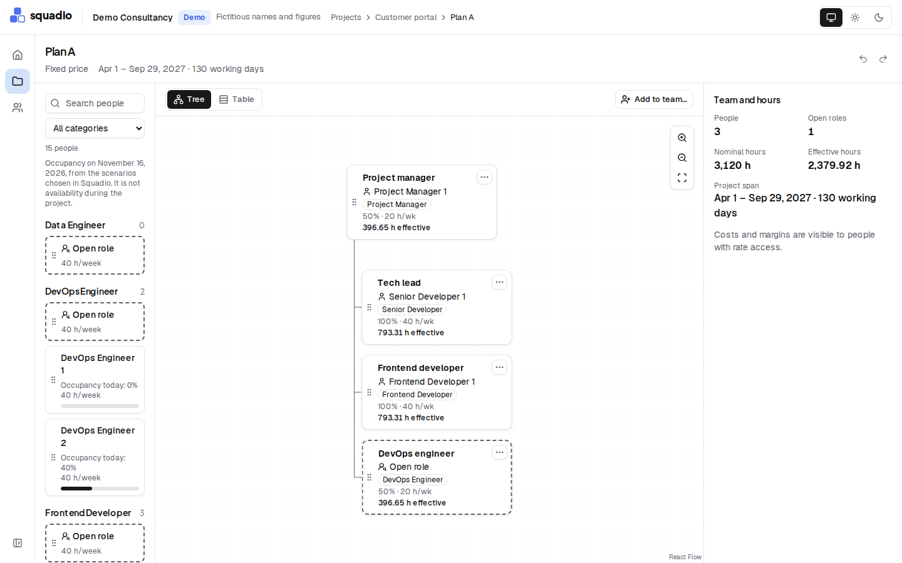

# Squadio

Staffing simulator for consultancies: build a project team by dragging people or open roles
into a scenario and see cost, margin and effective rate update live, before you commit.

**v0.6 is live** at [squadio.utitytools.com](https://squadio.utitytools.com): a synthetic demo
organization with its home page, projects, people and scenarios. Edit a scenario and watch cost and
margin follow every change; when data is missing, the estimate shows every line it can compute and
says what each other line is waiting for. Duplicate a scenario to try a variant, compare two or
three side by side, and see each person's load week by week, with the people the team over-allocates
flagged. Save a revision of a scenario, which never changes, and share its link: a reviewer opens
it, with no money unless they have rate access, and a member with rate access proposes an
alternative derived from it. Choosing
a scenario points at one of its revisions. An empty team starts from one of four example teams of
open roles, undone in one step. Your edits go to your own copy of the demo, kept for 30 days after
your last save. Signing in with GitHub or Google to work with your own organization, with its owner,
members and viewers, invitations by link and its categories and people imported from two CSV files,
is built but closed in production for now (see the [roadmap](docs/plan.md#roadmap)).



## Try the demo

Every figure and name is synthetic.

| Page                                                                                                                       | What it shows                                                             |
| -------------------------------------------------------------------------------------------------------------------------- | ------------------------------------------------------------------------- |
| [Home](https://squadio.utitytools.com/en/home)                                                                             | The organization at a glance, and the corrections its data is waiting for |
| [Customer portal](https://squadio.utitytools.com/en/projects/6d656d6f-0000-4000-8000-000000000100)                         | A project: its categories with their costs, and its scenarios to compare  |
| [Plan A](https://squadio.utitytools.com/en/scenarios/6d656d6f-0000-4000-8000-000000000200)                                 | The guide case team: tree and table views, the full summary rail          |
| [Plan A without rate access](https://squadio.utitytools.com/en/scenarios/6d656d6f-0000-4000-8000-000000000200?access=none) | Team and hours only: the server sends no money at all                     |
| [Over budget](https://squadio.utitytools.com/en/scenarios/6d656d6f-0000-4000-8000-000000000202)                            | Time and materials above its budget cap                                   |
| [Missing rate](https://squadio.utitytools.com/en/scenarios/6d656d6f-0000-4000-8000-000000000203)                           | A category without a rate: no cost, never 0 €, and a marker on the node   |
| [Missing price](https://squadio.utitytools.com/en/scenarios/6d656d6f-0000-4000-8000-000000000204)                          | A fixed-price project without a price: costs shown, margins pending       |
| [Delivery plan](https://squadio.utitytools.com/en/scenarios/6d656d6f-0000-4000-8000-000000000205)                          | A chosen scenario: a locked team, an over-allocated lead                  |
| [Its revision](https://squadio.utitytools.com/en/revisions/6d656d6f-0000-4000-8000-000000000500)                           | A revision that never changes: what a reviewer opens from a link          |

To compare scenarios, tick two or three on a project's page, or open
[Plan A and Plan B side by side](https://squadio.utitytools.com/en/projects/6d656d6f-0000-4000-8000-000000000100/compare?s=6d656d6f-0000-4000-8000-000000000200&s=6d656d6f-0000-4000-8000-000000000201).
Spanish is the default locale; drop `/en` from a link to see it in Spanish.

<p>
  
  
</p>
<p>
  
  
</p>
<p>
  
</p>
<p>
  
  
</p>
<p>
  
  
</p>

## How it works

- **One pure costing function per scenario** turns assignments, rates and cost settings into
  every result line, in integer cents, each line rounded once. The spec is
  [docs/domain.md](docs/domain.md); the reasoning is in [ADR 0002](docs/adr/0002-cost-model.md).
- **Partial results:** a missing rate, price or planned period never turns into 0 €. The engine
  computes every line it can, marks the others pending with what they miss, and the home page
  lists those corrections ([partial results](docs/domain.md#partial-results)).
- **Costs per category, never per person.** The app stores no individual salaries, and a category
  with one or two people carries a warning, since its rate reveals a salary
  ([ADR 0003](docs/adr/0003-structure-not-people.md)).
- **The database enforces who sees money.** Tenants are kept apart with forced Row Level Security,
  and money lives in restricted tables that return no rows without rate access
  ([ADR 0004](docs/adr/0004-tenant-isolation-with-rls.md),
  [ADR 0005](docs/adr/0005-rate-access-in-the-database.md)).
- **Two views of one team:** a tree drawn with React Flow and a compact layout, and an ARIA
  treegrid that is the default on narrow screens and the one screen readers get.
- **Every edit is a change the store can undo.** People and open roles are added from the bench by
  dragging, or from menus with the keyboard alone; ⌘Z and ⇧⌘Z (Ctrl+Z and Ctrl+Y elsewhere) undo
  and redo, and a pure change model rejects what the domain forbids. Changes are saved against a
  version, so a stale tab gets a conflict instead of overwriting newer work.
- **A visitor's first save makes their copy** of the demo, behind an anonymous cookie, and a daily
  job deletes copies idle for 30 days
  ([ADR 0011](docs/adr/0011-saving-edits-and-the-visitor-copy.md)).
- **Projects have a planned period.** New assignments start from it, undated recurring costs follow
  it, and an assignment outside it is flagged, never refused
  ([planned period](docs/domain.md#planned-period)).
- **Organizations and membership** ([ADR 0012](docs/adr/0012-sign-in-and-membership.md)): sign-in
  with GitHub or Google, an empty organization or one adopted from the visitor's copy, its own
  categories with their costs, people and projects, and the owner deleting the organization or
  their account. Membership is resolved on the server before any tenant query, and sign-up sits
  behind a switch that is off in production.
- **Choosing a scenario points it at a revision:** its team, price, period, rates and result stay
  as that revision holds them, and its team is locked until it is unchosen. Choosing an older
  revision lists what changed since first. The bench's occupancy comes from chosen scenarios.
- **Duplicating and comparing scenarios** ([comparing scenarios](docs/domain.md#comparing-scenarios)):
  a copy is a new draft with the same team and extra costs. Two or three scenarios of a project sit
  side by side, against the chosen one or else the first picked: result lines and their differences
  with rate access, team and hours for everyone, and an undetermined figure never shown as a
  difference.
- **Weekly load and over-allocation** ([weekly load](docs/domain.md#weekly-load)): the bench shows
  each person's load in every week of the scenario, counting the chosen scenarios of other
  projects, and the team flags whoever goes above 100% with the weeks and the projects behind it.
  Load is what Squadio knows: an empty week means nothing is registered, not that the person is
  free.
- **Revisions that never change** ([revisions](docs/domain.md#revisions),
  [ADR 0013](docs/adr/0013-scenario-revisions.md)): a snapshot in an open part and a restricted one,
  with the rules version it was costed with, in two tables the app cannot update. Its page is a link
  for signed-in members and visitors, and without rate access it shows structure, hours and dates,
  never money. «Propose an alternative» on a revision makes a new draft of the same project that
  remembers where it came from.
- **Roles and invitations** ([ADR 0015](docs/adr/0015-roles-and-invitations.md)): owner, member with
  rate access and viewer without it. The owner invites by a link they copy, with no mail provider,
  and changes roles or removes members; a viewer's transactions are read only in the database.
- **Importing a spreadsheet** ([importing a spreadsheet](docs/domain.md#importing-a-spreadsheet),
  [ADR 0016](docs/adr/0016-spreadsheet-import.md)): a member brings the organization's categories
  with their costs, then its people, from two CSV files and a template. The file is read and
  checked in the browser by pure functions; a review marks each row ready, with a warning or with
  an error, lets a cell be fixed in place and downloads an error report; a Server Action writes
  every row or none. A person whose name exists is updated, and an empty cell never erases a value.
- **Starting from an example team**
  ([example team](docs/domain.md#starting-from-an-example-team)): an empty scenario offers four
  teams of open roles, from a proof of concept to maintenance, each role matched to one of the
  organization's categories or left out. They are added as one change, which one undo takes back,
  and no money reaches the picker.

The vocabulary is in the [glossary](docs/glossary.md) and every decision in [docs/adr](docs/adr).

## Quality

Each claim here is checked in CI on every pull request ([ci.yml](.github/workflows/ci.yml)):

- **Every commit** passes lint (zero warnings), strict types, format and unit tests on its own, so
  the history stays bisectable.
- **Unit and property-based tests** (Vitest, fast-check) cover the costing engine's invariants:
  a full year costs exactly the fully loaded annual cost, adding someone never lowers the cost.
- **Database tests** run against Postgres 18 with the production roles: tenant isolation and rate
  access are tested in the database, not mocked.
- **End-to-end tests** (Playwright) run on a production build, with axe (WCAG 2.2 AA and best
  practices) in the light and dark themes and with and without rate access.

The weekly load is measured with a synthetic consultancy of 150 people and 30 other projects'
chosen scenarios ([the test](tests/db/weekly-load-scale.db.test.ts)): loading a scenario with its
1,500 commitments took 7.3 ms and recalculating after an edit 3.3 ms, on a laptop, on 2026-11-19.
The test prints the times and asserts none, so CI stays steady.

## Stack

Next.js 16 (App Router, Server Components, Cache Components, React Compiler), React 19,
TypeScript strict, Tailwind CSS v4 and shadcn/ui, React Flow, next-intl, Postgres 18 (Neon) with
Drizzle and Row Level Security, Better Auth, Zod, Vitest, fast-check and Playwright. Deployed on
Vercel from GitHub Actions. Why each one: [ADR 0001](docs/adr/0001-stack-and-workflow.md).

## Getting started

Requirements: Node 24 (see `.nvmrc`), pnpm and Docker.

```bash
pnpm install
cp .env.example .env.local
docker compose up -d --wait   # Postgres 18 on 127.0.0.1:5434
pnpm db:migrate               # as the owner role
pnpm db:seed                  # the synthetic demo organization
pnpm dev                      # http://localhost:3000
```

The scripts are listed in [AGENTS.md](AGENTS.md#commands): tests, database tests and E2E.

## Environment variables

[`.env.example`](.env.example) lists every variable. They are validated with Zod in
[`src/lib/env/schema.ts`](src/lib/env/schema.ts): `next dev` and `next build` stop with the name of
any missing or invalid variable. Server code reads them from `src/env.ts` (server-only) and client
code from `src/env.client.ts`, never from `process.env` directly.

## Database

Postgres 18 runs in Docker from [`docker-compose.yml`](docker-compose.yml), the same file CI uses.
Two roles keep tenants apart ([ADR 0004](docs/adr/0004-tenant-isolation-with-rls.md)):
`squadio_owner` runs migrations and owns every object; the app connects as `squadio_app`, which
cannot bypass Row Level Security. Neither is a superuser, as in production, so forced Row Level
Security binds the owner too. The `postgres` superuser only runs the init script in
[`docker/postgres/init`](docker/postgres/init).

There are two databases: `squadio` for `pnpm dev` and `pnpm db:migrate`, and `squadio_test` for
`pnpm test:db` and CI. Credentials are synthetic and local-only.

The init script runs only when the data volume is created. To start again from empty databases, or
after the init script changes, recreate the volume:

```bash
docker compose down --volumes && docker compose up -d --wait
```

## License

[MIT](LICENSE)
