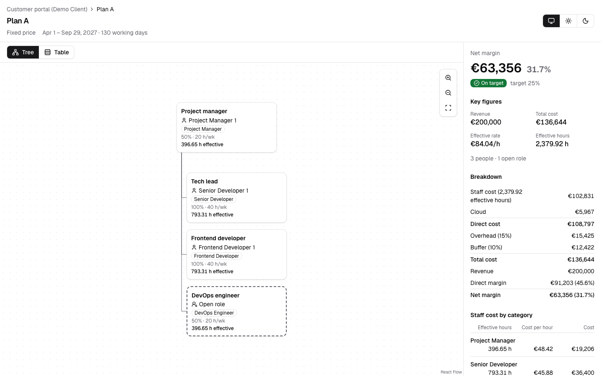
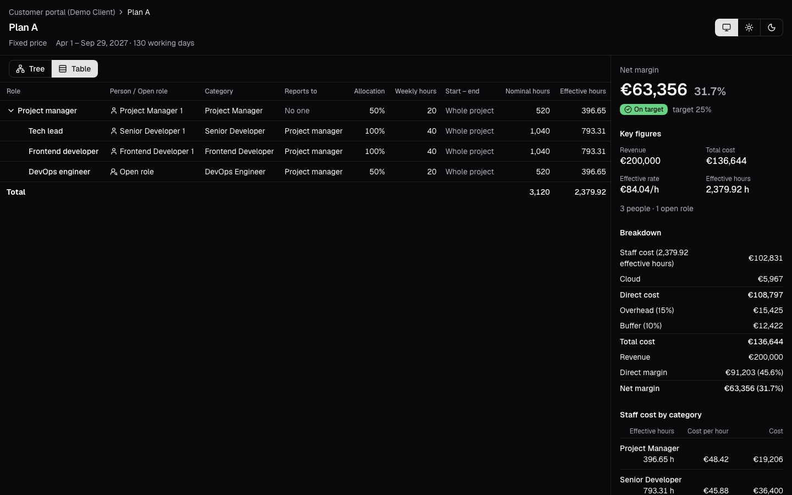
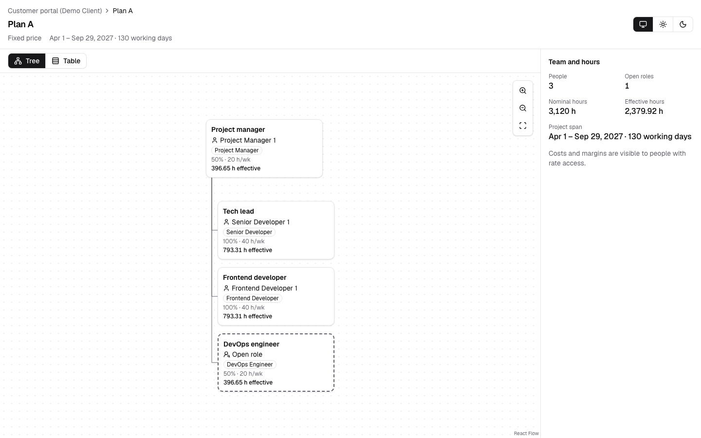

# Squadio

Staffing simulator for consultancies: build a project team by dragging people or open roles
into a scenario and see cost, margin and effective rate update live, before you commit.

**v0.1 is live** at [squadio.utitytools.com](https://squadio.utitytools.com): the costing engine and
a read-only scenario canvas over a synthetic demo organization. Editing scenarios comes in v0.2
(see the [roadmap](docs/plan.md#roadmap)).



## Try the demo

Every figure and name is synthetic.

| Scenario                                                                                                                   | What it shows                                                           |
| -------------------------------------------------------------------------------------------------------------------------- | ----------------------------------------------------------------------- |
| [Plan A](https://squadio.utitytools.com/en/scenarios/6d656d6f-0000-4000-8000-000000000200)                                 | The guide case team: tree and table views, the full summary rail        |
| [Plan A without rate access](https://squadio.utitytools.com/en/scenarios/6d656d6f-0000-4000-8000-000000000200?access=none) | Team and hours only: the server sends no money at all                   |
| [Over budget](https://squadio.utitytools.com/en/scenarios/6d656d6f-0000-4000-8000-000000000202)                            | Time and materials above its budget cap                                 |
| [Missing rate](https://squadio.utitytools.com/en/scenarios/6d656d6f-0000-4000-8000-000000000203)                           | A category without a rate: no cost, never 0 €, and a marker on the node |
| [Missing price](https://squadio.utitytools.com/en/scenarios/6d656d6f-0000-4000-8000-000000000204)                          | A fixed-price project without a price                                   |

Spanish is the default locale; drop `/en` from a link to see it in Spanish.

<p>
  
  
</p>

## How it works

- **One pure costing function per scenario** turns assignments, rates and cost settings into
  every result line, in integer cents, each line rounded once. The spec is
  [docs/domain.md](docs/domain.md); the reasoning is in [ADR 0002](docs/adr/0002-cost-model.md).
- **Costs per category, never per person.** The app stores no individual salaries, and a category
  with one or two people carries a warning, since its rate reveals a salary
  ([ADR 0003](docs/adr/0003-structure-not-people.md)).
- **The database enforces who sees money.** Tenants are kept apart with forced Row Level Security,
  and money lives in restricted tables that return no rows without rate access
  ([ADR 0004](docs/adr/0004-tenant-isolation-with-rls.md),
  [ADR 0005](docs/adr/0005-rate-access-in-the-database.md)).
- **Two views of one team:** a tree drawn with React Flow and a compact layout, and an ARIA
  treegrid that is the default on narrow screens and the one screen readers get.

The vocabulary is in the [glossary](docs/glossary.md) and every decision in [docs/adr](docs/adr).

## Quality

Each claim here is checked in CI on every pull request ([ci.yml](.github/workflows/ci.yml)):

- **Every commit** passes lint (zero warnings), strict types, format and unit tests on its own, so
  the history stays bisectable.
- **Unit and property-based tests** (Vitest, fast-check) cover the costing engine's invariants:
  a full year costs exactly the fully loaded annual cost, adding someone never lowers the cost.
- **Database tests** run against Postgres 18 with the production roles: tenant isolation and rate
  access are tested in the database, not mocked.
- **End-to-end tests** (Playwright) run on a production build, with axe (WCAG 2.2 AA and best
  practices) in the light and dark themes and with and without rate access.

Performance figures will appear here once they are measured.

## Stack

Next.js 16 (App Router, Server Components, Cache Components, React Compiler), React 19,
TypeScript strict, Tailwind CSS v4 and shadcn/ui, React Flow, next-intl, Postgres 18 (Neon) with
Drizzle and Row Level Security, Zod, Vitest, fast-check and Playwright. Deployed on Vercel from
GitHub Actions. Why each one: [ADR 0001](docs/adr/0001-stack-and-workflow.md).

## Getting started

Requirements: Node 24 (see `.nvmrc`), pnpm and Docker.

```bash
pnpm install
cp .env.example .env.local
docker compose up -d --wait   # Postgres 18 on 127.0.0.1:5434
pnpm db:migrate               # as the owner role
pnpm db:seed                  # the synthetic demo organization
pnpm dev                      # http://localhost:3000
```

The scripts are listed in [AGENTS.md](AGENTS.md#commands): tests, database tests and E2E.

## Environment variables

[`.env.example`](.env.example) lists every variable. They are validated with Zod in
[`src/lib/env/schema.ts`](src/lib/env/schema.ts): `next dev` and `next build` stop with the name of
any missing or invalid variable. Server code reads them from `src/env.ts` (server-only) and client
code from `src/env.client.ts`, never from `process.env` directly.

## Database

Postgres 18 runs in Docker from [`docker-compose.yml`](docker-compose.yml), the same file CI uses.
Two roles keep tenants apart ([ADR 0004](docs/adr/0004-tenant-isolation-with-rls.md)):
`squadio_owner` runs migrations and owns every object; the app connects as `squadio_app`, which
cannot bypass Row Level Security. Neither is a superuser, as in production, so forced Row Level
Security binds the owner too. The `postgres` superuser only runs the init script in
[`docker/postgres/init`](docker/postgres/init).

There are two databases: `squadio` for `pnpm dev` and `pnpm db:migrate`, and `squadio_test` for
`pnpm test:db` and CI. Credentials are synthetic and local-only.

The init script runs only when the data volume is created. To start again from empty databases, or
after the init script changes, recreate the volume:

```bash
docker compose down --volumes && docker compose up -d --wait
```

## License

[MIT](LICENSE)
